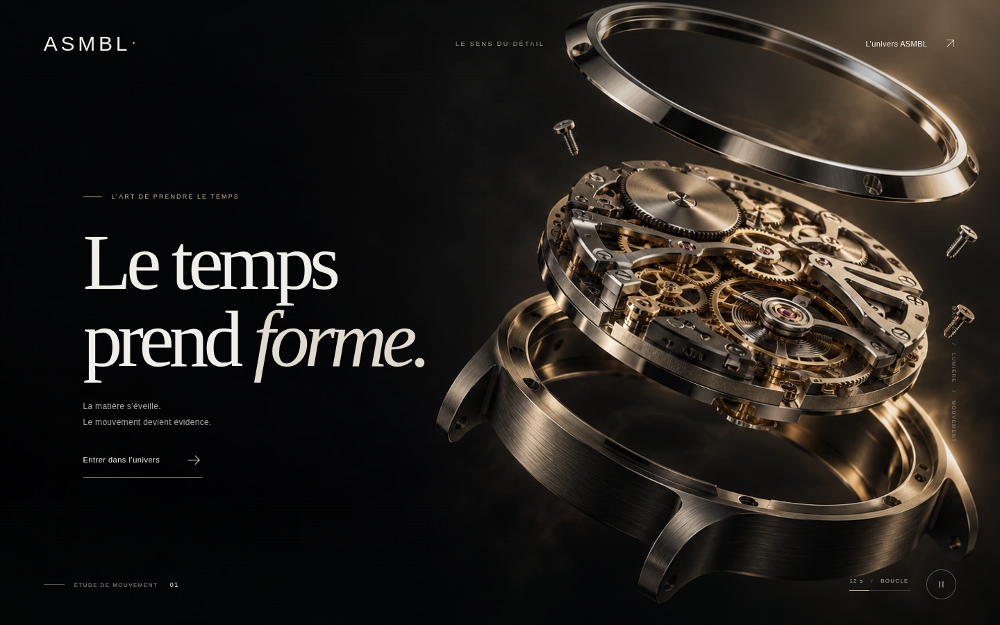

# ASMBL — Le temps prend forme.

Motion design de concept pour le Hero de la page d’accueil : clair-obscur, métal brossé, lumière champagne et boucle animée de 12 secondes.



## Voir la création

- [Film ordinateur — MP4, Full HD, 12 secondes](hero-motion/assets/asmbl-hero.mp4)
- [Film mobile — MP4, 1080 × 1350](hero-motion/assets/asmbl-hero-mobile.mp4)
- [Film ordinateur — WebM](hero-motion/assets/asmbl-hero.webm)
- [Aperçu mobile](hero-motion/assets/preview-mobile.png)
- [Télécharger le dossier complet](ASMBL-Hero-Motion.zip)

Pour télécharger une vidéo depuis GitHub, ouvrir son fichier puis utiliser **Download raw file**. Les films ne contiennent ni texte ni son ; le titre et le bouton sont des éléments HTML dans la maquette.

## Lancer la maquette

Depuis la racine du dépôt, avec Python 3 :

```sh
python -m http.server 8080 --bind 127.0.0.1 --directory hero-motion
```

Ouvrir ensuite la page `index.html` servie par ce serveur dans un navigateur. La maquette ne nécessite aucune installation de dépendances. Le serveur est local ; ce dépôt n’active pas automatiquement un site public.

- `hero-motion/index.html` : maquette complète du Hero, animation WebGL, pause, cadrage mobile et dialogue de téléchargement.
- `hero-motion/integration.html` : exemple d’intégration utilisant directement les vidéos MP4.
- `hero-motion/motion.js` : source de l’animation 2,5D.
- `hero-motion/tools/render.cjs` : export reproductible des vidéos avec Playwright, Chromium et FFmpeg.
- [Documentation et vérifications détaillées](hero-motion/README.md).

## Périmètre du concept

Le site `asmbl.watch` n’a pas pu être consulté dans l’environnement de création, car son accès réseau était bloqué. Le mécanisme est un visuel généré de concept, et ne représente pas un modèle ASMBL vérifié. L’identité visuelle et les références produit devront être validées avant utilisation commerciale. Aucun changement n’a été publié sur le site de production.
